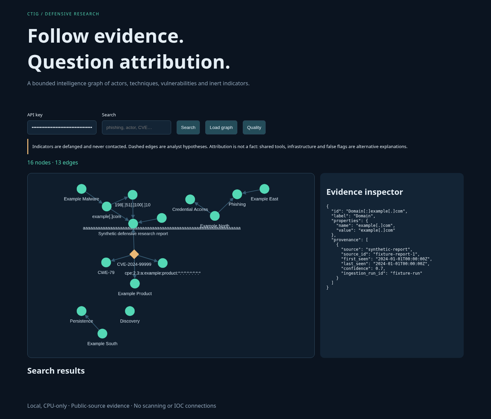
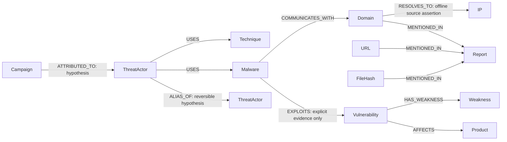

# Cyber Threat Intelligence Graph

An evidence-aware, defensive intelligence platform connecting threat actors, malware, tools, campaigns, ATT&CK techniques, CVEs, CWEs, products, reports and inert indicators. Python 3.12, Neo4j Community, NetworkX, MiniLM + FAISS, FastAPI and a locally bundled Cytoscape.js UI. CPU only.

**Implemented across all 19 phases.** A reproducible synthetic demo and tests run without public feeds. Real ATT&CK v16.1/v17.1 data were collected, ingested and temporally evaluated. Live KEV/NVD/CWE collection remains pending current terms verification/access; alias labels, real-world golden answers and laptop memory measurements require independent human work. No results are fabricated. See [validation](reports/VALIDATION.md), [evaluation](docs/EVALUATION.md) and [sources](DATA_SOURCES.md).



## What the graph answers

Which techniques are shared by actors? Which source supports a malware/infrastructure assertion? What reports mention an indicator? What products and weaknesses relate to a CVE? Which CVEs deserve investigation under an explainable heuristic? Which new ATT&CK assertions would older graph/text features rank as analyst leads?

Graphs make heterogeneous multi-hop relationships easier to explore than repeated relational joins; they do not make attribution more certain. Every relationship has provenance, confidence and dates. Co-mentions never become attribution. Read [modeling decisions](docs/MODELING.md).



This diagram describes supported relationships, not claims that every edge exists in the sample.

## Safety contract

1. **Defensive only.** No scanning, probing, exploitation, malware execution or indicator network connections.
2. **Indicators are data.** No live DNS resolution or HTTP requests to IOCs. Browsing output is defanged. Machine STIX export explicitly emits canonical SCO values and must be handled as inert data.
3. **Attribution is a hypothesis.** Show evidence, source confidence and caveats: shared tools/infrastructure and false flags. Predictions are leads, never facts.
4. **Parameterized Cypher.** Data values are parameters; schema identifiers come from static allowlists. User/LLM query paths accept exact read-only templates only, enforce timeout/row bounds and require an expiring signed preview followed by explicit confirmation.
5. **Untrusted text.** Sanitize it and render through textContent. Optional LLM interface uses system instructions plus delimited JSON data and validates template output. FakeLLM is the only included provider.
6. **No secret or feed dumps in Git.** .env, raw/processed data, database files, logs and model caches are ignored. Authored small fixtures and aggregate results are committed.

## Quick start — LOCAL

Run from this repository root in a POSIX terminal (Linux/macOS or WSL with Docker Desktop). Use Python **3.12**, Docker Engine + Compose v2, Git and VS Code. The dependency locks were resolved/tested on Python 3.12; Python 3.10 is not the pinned supported environment.

```bash
git clone https://github.com/GaurikMehrotra/-Cyber-Threat-Intelligence-Graph.git
cd -- -Cyber-Threat-Intelligence-Graph
python3.12 -m venv .venv
source .venv/bin/activate
python -m pip install -r requirements.txt
python -m pip install --no-deps --no-build-isolation -e .
python -m scripts.init_env
make demo
make integration
make run
```

`init_env` creates private .env credentials once and preserves an existing file. No keys are printed. Open your local app at port 8000 using your own browser; enter CTIG_API_KEY from your private .env. Swagger/OpenAPI is at `/docs`; use its Authorize control. The synthetic demo has **16 nodes and 13 relationships**, a single synthetic CVE and RFC documentation indicators. Repeated `make demo` does not add duplicates. `make db-down` stops Neo4j without deleting its named data volume.

The core-only install passes55 tests with one optional FAISS test skipped. After `make ml`, the full integration run passes56 tests with no skips.

For an entirely database-free API demo:

```bash
CTIG_BACKEND=fixture CTIG_CONFIG=configs/fast_debug.yaml python -m app.app
```

Authentication still requires CTIG_API_KEY from .env. Cypher execution requires Neo4j. If using commands outside the repository root, pass config/data paths explicitly. `code .` opens VS Code; select .venv/bin/python.

### CPU ML and semantic search

```bash
make ml
python -m src.cli index --mode sentence
CTIG_INDEX=data/processed/index python -m app.app
# In another activated terminal, send a request using .env without printing its key:
python - <<'PYCODE'
import os
import httpx
from dotenv import load_dotenv
load_dotenv(".env")
r = httpx.get('http://127.0.0.1:8000/api/search',
    params={'q': 'credential phishing', 'semantic': 'true', 'limit': 5},
    headers={'X-API-Key': os.environ['CTIG_API_KEY']})
r.raise_for_status()
print(r.json())
PYCODE
```

Torch is pinned to a **+cpu** wheel from the official CPU index. MiniLM revision is pinned, uses CPU/two threads/batch16, and caches bounded embeddings to disk. FAISS uses exact inner product over normalized vectors. TF-IDF is an explicitly labeled debug fallback, not a claim of semantic model equivalence:

```bash
python -m src.cli index --mode tfidf --directory data/processed/debug-index
CTIG_CONFIG=configs/fast_debug.yaml CTIG_INDEX=data/processed/debug-index python -m app.app
```

### Public sources and temporal experiments

First review [DATA_SOURCES.md](DATA_SOURCES.md) and the publishers' **current** terms, attribution, rate limits and endpoints. The acknowledgment flag does not verify them for you.

```bash
# Only the verified ATT&CK source; full enterprise/mobile/ICS for both releases:
python -m src.cli collect --accept-source-terms --sources attack
python -m src.cli load --graph data/processed/public-graph.json
python -m src.cli quality --graph data/processed/public-graph.json
python -m src.cli analytics --graph data/processed/public-graph.json
python -m src.cli predict --old data/processed/attack-v16.1.json   --new data/processed/attack-v17.1.json --sentence   --output reports/local/attack-temporal.json
python -m src.cli index --graph data/processed/public-graph.json   --directory data/processed/public-index --mode sentence
CTIG_INDEX=data/processed/public-index python -m app.app
```

After verifying CISA, NVD and CWE terms/access (not verified in the cloud build):

```bash
python -m src.cli collect --accept-source-terms --sources attack kev cwe --with-nvd
```

NVD collection can take hours: 6.1 seconds per CVE, cached, recent KEV-referenced CVEs only, <=3,000 requests. A failed publisher request stops collection; already cached ATT&CK snapshots remain available. No IOC publisher is silently selected. Import permissively licensed reports/IOCs **offline**, never by visiting indicator destinations:

```bash
python -m src.cli ingest --kind report --input data/fixtures/report.json
python -m src.cli ingest --kind ioc --input data/fixtures/iocs.json   --source synthetic-iocs --source-id authored-sample
python -m src.cli load --graph data/processed/graph.json
```

The default database may contain both public and synthetic records after these commands. Provenance distinguishes them. For a fixture-only validation, use a separate fresh Compose project/data volume; do not delete user volumes. For a graph larger than the configured export bounds, select a JSON list of IDs under ignored data/processed and set CTIG_SUBGRAPH to that file. Full-database NetworkX analysis is refused beyond the caps.

## API

All `/api/*` endpoints require `X-API-Key`; unauthenticated health/UI/docs do not disclose graph contents. Default 60 authenticated requests/minute, one Uvicorn worker, 64KiB bodies, <=100 paginated rows, <=200 rendered nodes, pivot depth<=3.

| Endpoint | Behavior |
|---|---|
| GET /api/entity?id=… | Identifier lookup, defanged IOC output and evidence |
| GET /api/search?q=… | Name/description/alias search; semantic=true uses configured persisted index |
| GET /api/neighbors?id=… | Paginated observed neighbors and source evidence |
| GET /api/shortest-path?source=…&target=… | Observed bounded-subgraph shortest path, no attribution inference |
| GET /api/pivot?id=…&depth=2 | Hub-filtered bounded infrastructure neighborhood |
| GET /api/similar-actors?id=… | Technique Jaccard; embedding=true optionally adds configured text cosine |
| GET /api/actor-profile?id=… | Actor's observed ATT&CK techniques with provenance |
| GET /api/cve-context?id=… | Product/weakness/report context and explainable heuristic priority |
| GET /api/quality | Bounded graph quality report |
| GET /api/stix | Explicit STIX 2.1 interchange; custom CWE/product objects, canonical SCO values |
| GET /api/visualization | <=200 nodes, provenance on click, dashed inferred links |
| POST /api/query/preview | Return allowlisted Cypher, exact parameters and signed expiring token; does not execute |
| POST /api/query/execute | Same template/params + preview_token + confirmed=true; timed READ query |
| POST /api/nl/preview | Optional FakeLLM interface; disclosed fixed demo template, never executes |

A source assertion's confidence is not a calibrated probability. Actor similarity and graph paths do not establish identity or attribution. Keys stay in .env; the UI keeps the entered value in memory only. This is a local single-user service; production/multi-user hardening is described in [THREAT_MODEL.md](THREAT_MODEL.md).

## Evaluation and quality commands

```bash
make lint security integration audit
python -m src.cli resolve --sentence
python -m src.cli er-eval --pairs data/eval/alias_pairs.csv
python -m src.cli golden --questions data/eval/golden_queries.json
# Synthetic-only database, independent expected fixture answers:
python -m src.cli golden --questions data/eval/fixture_golden.json
python -m src.cli predict --sentence
python -m src.cli benchmark
docker stats --no-stream
python -m scripts.smoke_api
```

The label templates deliberately return `unlabeled`/null metrics until reviewed. No zero-test “pass.” See [temporal protocol and limits](docs/EVALUATION.md) and [measured results](reports/VALIDATION.md). Public ATT&CK release changes are not incident-time ground truth. False alias merges are costlier than missed aliases. The prioritization score is a configurable heuristic (KEV .50, CVSS .20, observed degree .15, PageRank .10, optional EPSS .05), with missing inputs disclosed; it is not an exploitation probability.

Purge unsupported data while ingestion is paused:

```bash
python -m src.cli purge --neo4j --source synthetic-report
# Offline snapshot purge, writes a new file:
python -m src.cli purge --graph data/fixtures/graph.json --run fixture-run   --output data/processed/purged.json
```

Both node and relationship observations are tracked; shared evidence survives source removal. ALIAS_OF approvals and undo live in src/resolve/review_queue.py and are tested; no destructive entity merging occurs.

## Resources and documentation

Neo4j image is fixed at 5.26.27-community (validated image digest recorded in reports). Heap 512–768MiB, page cache512MiB, transaction memory128MiB, container2GiB, two CPUs. Exact setting names were checked against the official image's configuration and runtime validation; the web documentation page was blocked, so we do not claim to have read it. [Current official Docker setting reference](https://neo4j.com/docs/operations-manual/current/docker/ref-settings/). Recheck the pinned driver's official docs when changing versions; managed transactions use `unit_of_work(timeout=…)`, while implicit session queries accept `Query(timeout=…)`.

NetworkX exports <=5,000 nodes/30,000 edges, embeddings <=5,000 documents, candidates<=300,000. Keep experiments sequential on the 8GB laptop. Cloud runs are below the 6GB target, but laptop peak memory must be measured separately. No Kaggle/GPU workflow is required for implemented methods; optional node2vec/Kaggle extensions are not claimed as implemented experiments.

[All 19 phase commands and checkpoints](docs/PHASES.md) · [Schema and modeling](docs/MODELING.md) · [Evaluation](docs/EVALUATION.md) · [Sources/attribution](DATA_SOURCES.md) · [Threat model](THREAT_MODEL.md) · [Run notebooks](notebooks/01_data_exploration.ipynb)

Folders follow the requested layout: reusable code in src, configuration in configs, schema/queries in cypher, authored fixtures and evaluation templates in data, notebooks for exploration only, API UI in app, pytest tests in tests, GitHub Actions in .github/workflows, aggregate artifacts in reports. The full code is committed in files; there are no “rest of code” placeholders.

## Limitations and next independent work

- Current live KEV/NVD/CWE terms/access were not verified; their parsers and linking are fixture-tested. Choose current permitted IOC/report sources yourself; none are fetched implicitly.
- Supply 100 independently labeled alias pairs and 30 real-world golden answers. Synthetic correctness and temporal release metrics do not replace expert CTI verification.
- CWE/product export uses explicit custom STIX objects; schema alignment does not guarantee interoperability with every downstream tool.
- Latest-property aggregation can hide disagreements in the materialized view; individual source observations remain available for inspection/removal. Source confidence is not inferred attribution confidence.
- Performance artifacts are small cloud experiments; rerun on your laptop and save results under reports/local. The index experiment is synthetic, not a blanket index-speed claim.
- Optional real LLM and random-walk classifier/Kaggle extensions are not implemented/enabled; the FakeLLM adapter is tested and no paid service is required.

License: MIT for project code and original fixtures. MITRE ATT&CK notices remain separate under licenses/. Cytoscape.js license is bundled with the local JS artifact. See DATA_SOURCES.md before redistributing derived data.
